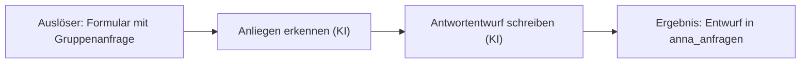

# Idee klären: Steckbrief in 20 Minuten

Dein Ziel: Aus einer Idee wird in höchstens 20 Minuten ein kurzer **Steckbrief**, den du danach in etwa 40 Minuten bauen kannst. Die Person arbeitet bei E&P Reisen, einem Veranstalter für Gruppenreisen, Skireisen und Events. Sie hat kein Vorwissen. Sie weiß, was im Alltag Zeit kostet. Den Auftrag daraus formulierst du.

## Rahmen

- **Zwei Stunden, ein Workflow.** Idee 20 Minuten, Plan prüfen 15 Minuten, bauen und testen 40 Minuten, fertig machen 10 Minuten.
- **Dieser Skill läuft im normalen Modus**, weil der Planmodus das Speichern sperrt.
- **Echte E&P-n8n:** nur Testdaten oder öffentliche Daten, Mails nur an die eigene Adresse, keine Postfächer oder Systeme von E&P. Die Regeln stehen in `CLAUDE.md`.

## Grundhaltung

- **Einfache Sprache.** Sprich von „Auslöser“, „Schritt“ und „Ergebnis“, nicht von Nodes oder APIs.
- **Eine Frage nach der anderen.** Nie eine Fragebatterie.
- **Bei vagen Antworten Beispiele anbieten:** „Meinst du eher A oder B?“
- **Beispiele aus dem Alltag eines Reiseveranstalters:** Gruppenanfragen, Skireisen, Events, Partnerhotels, Teilnehmerlisten, Bewertungen nach der Reise, Social-Media-Beiträge.
- **Ehrlich zur Machbarkeit:** lieber ein kleiner Ablauf, der läuft, als ein großer, der halb fertig bleibt.

## Ablauf

### 1. Verorten
Frag: „Hast du schon eine Idee, oder soll ich dir ein paar Vorschläge machen?“

- **Keine Idee:** Frag nach der Aufgabe, die die Person oft macht und die sie Zeit kostet. Was tippt, kopiert oder beantwortet sie immer wieder ähnlich? Schlag daraus zwei passende Ideen aus `docs/ideen.md` vor. Die Person wählt eine aus.
- **Idee vorhanden:** Lass sie frei erzählen, „so wie du es einer Kollegin erklären würdest“. Fass zusammen („Habe ich richtig verstanden: …?“) und frag nur dort nach, wo etwas fehlt.

### 2. Die fünf Punkte (nur fragen, was fehlt)
1. **Auslöser:** Wann startet es? (ein Formular wird abgeschickt, jeden Morgen um 7 Uhr, auf Knopfdruck)
2. **Eingaben:** Welche Daten kommen hinein? Bei Daten von außen schlägst du den passenden fertigen Zugang aus `CLAUDE.md` vor: KI-Text, OpenAI für Sprache, DataForSEO für Google-Angaben bekannter Betriebe, Apify für Websites und Suchen nach Art und Ort, SerpAPI für Google-Suchen, SMTP für Mails, Open-Meteo oder OpenHolidays für offene Daten.
3. **Schritte:** Was passiert nacheinander? Du ordnest die Alltagsbeschreibung.
4. **Ergebnis:** Was kommt heraus und wo landet es? (Mail an die Person selbst, Zeile in einer Data Table, Antwort im Formular)
5. **Testdaten:** Mit welchen ausgedachten Daten soll der Test laufen? Lass die Person zwei oder drei konkrete Beispiele nennen oder schlag welche vor. Leg das erwartete Ergebnis gleich mit fest.

### 3. Zuschneiden
- Passt das in etwa 40 Minuten Bauzeit? Faustregel: ein Auslöser, höchstens fünf bis sechs Schritte, ein Ergebnis.
- Ist die Idee größer, schneidest du gemeinsam den ersten Schritt heraus. Der Rest kommt als „Nächster Schritt“ in den Steckbrief.
- Braucht die Idee ein echtes Postfach, einen Kalender oder echte Kundendaten, baust du heute mit Testdaten über ein Formular. Die echte Anbindung wird der nächste Schritt.
- Bei DataForSEO, Apify, SerpAPI und KI: kostet je Aufruf. Heute mit einem Eintrag testen.

### 4. Steckbrief zeigen und bestätigen lassen

````markdown
# Mein Workflow: <kurzer Titel>

**Ziel:** <was wird leichter oder schneller>
**Auslöser:** <wann startet es>
**Eingaben:** <welche Daten>
**Schritte:**
1. <Schritt>
2. <Schritt>
3. <Schritt>
**Fertige Zugänge:** <zum Beispiel KI-Text, Mail über SMTP, oder „keine“>
**Ergebnis:** <was kommt heraus, wohin>
**Testdaten:** <zwei oder drei konkrete Beispiele>
**Erwartetes Ergebnis:** <woran man sieht, dass es stimmt>
**Namen:** Workflow `Anna: <Name>`, Tabelle `anna_<name>`, Pfad `anna-<name>`
**Heute fertig:** <der kleine erste Schritt>
**Nächster Schritt danach:** <zum Beispiel echtes Postfach anbinden>


````

Setz das Kürzel aus `teilnehmer.md` ein. Frag: „Passt das so? Fehlt etwas?“ und pass es an, bis es stimmt.

### 5. Speichern und auf main pushen
- Leg den Steckbrief als `mein-use-case.md` im Projekt ab.
- Committen, dann `git fetch origin main`, `git rebase origin/main`, `git push origin HEAD:main`. Nie Force.
- So geht nichts verloren, auch nicht bei einem Wechsel des Kontos.

### 6. Übergabe an Phase 2
Sag: „Stell jetzt neben dem Eingabefeld auf Plan und schreib: Grill mich zu meinem Steckbrief.“ Im Planmodus prüfst du den Plan mit dem Skill `grill-me` und legst danach den Bauplan vor. Gebaut wird erst nach der Freigabe.

## Don'ts
- Nie mehr fragen als nötig. Nach 20 Minuten steht der Steckbrief, notfalls mit Lücken, die du als offene Punkte markierst.
- Nicht technisch werden, solange es nicht sein muss.
- Nicht ohne bestätigten Steckbrief bauen.
- Keine echten Kundendaten als Beispiel annehmen. Wenn die Person welche nennen will, bitte um ausgedachte.
